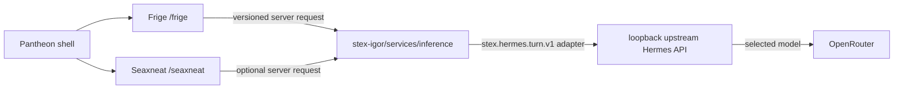

# STEX Pantheon — A0 baseline with H1 Hermes preparation

STEX is a local-first suite of independently owned creative applications. A0 implements Frige and Seaxneat under one loopback shell; Eostre and Woden are registered deferred products, not partial implementations.

Each application owns its own state. Pantheon routes HTTP but stores no
projects. Frige owns manuscript/proof state; Seaxneat owns ignored local
workspaces and Git history. `vault/` is an optional User Graph, never a shared
database. `services/knowledge` exposes only a replaceable read-only adapter.
`stex-igor/runtime/hermes-agent` pins the upstream source as a suite unit;
`stex-igor/hermes/` holds STEX's declarative roles and profiles. `stex-igor/services/inference`
remains the authenticated, bounded application-facing inference contract and
is the only STEX process allowed to call the upstream loopback API. Upstream
Hermes owns `OPENROUTER_API_KEY` and its model selection; STEX holds only its
separate local API credential. Igor is the user-facing identity, Hermes is the
runtime and protocol name.

The checked-in runtime-profile manifest maps one active `igor` runtime profile
to the Pantheon Director and seven inactive specialist profiles to the remaining
STEX roles. The local Igor gateway is loopback-only and tool-free; a read-only
reconciliation command checks the profile catalog, OpenRouter provider
selection, and empty CLI/API-server toolsets. This does not make the
specialists autonomous workers or grant them state, credentials, or authority.

The H1 adapter translates the stable STEX turn envelope to authenticated
OpenAI-compatible Chat Completions by default, with an evaluated Responses
mode for persisted runtime sessions. Pantheon persists an opaque conversation
identity in local browser storage; Frige retains its own book/section/piece
threads and transmits only the selected scope. The adapter derives opaque,
product-scoped upstream session identifiers to avoid cross-product collisions.

Upstream Hermes has terminal, filesystem, web, delegation, and scheduling
capabilities. H1 therefore remains conversational-only and refuses remote
turns until an operator explicitly acknowledges a verified OS/container
boundary and declares that policy. The acknowledgement is not a technical
proof of isolation. `tools: []` on the adapter request is defense in depth, not the
security boundary. The local fake enables deterministic workflows. One bounded,
provider-backed Hermes exchange has been verified directly through the local
Igor gateway; the Igor application and Frige still use the fake transport, and
their remote workflows remain unverified. Any additional provider call requires explicit
authorization and a bounded budget.

See [STATUS.md](STATUS.md) and [protocol documentation](../protocol/README.md).
