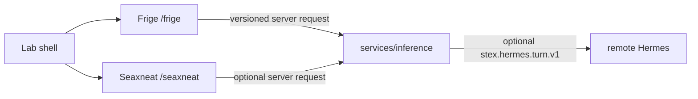

# STEX Pantheon A0

STEX is a local-first suite of independently owned creative applications. A0 implements Frige and Seaxneat under one loopback shell; Eostre and Woden are registered deferred products, not partial implementations.

Each application owns its own state. Lab routes HTTP but stores no projects. Frige owns manuscript/proof state; Seaxneat owns ignored local workspaces and Git history. The optional vault is user knowledge, never a shared database. `stex.hermes.turn.v1` is an authenticated, bounded client contract; its local fake enables deterministic A0 workflows. Remote Hermes and providers are not verified in A0.

See [STATUS.md](STATUS.md) and [protocol documentation](../protocol/README.md).
