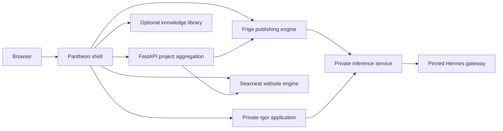

# STEX Pantheon whitepaper

STEX Pantheon gives creative tools a common web workspace while each tool
retains authority over its own data. The current suite serves publishing
and website development, composes Igor conversations through an HTTP
interface, and can keep explicitly accepted knowledge metadata locally.

## Repository and deployment map

| Location | Responsibility |
| --- | --- |
| [apps/pantheon](../apps/pantheon/README.md) | Shared shell, same-origin proxies, and Frige and Seaxneat presentation under its workspaces directory |
| [apps/frige](../apps/frige/README.md) | Manuscripts, proposals, revision acceptance, proof generation and preflight |
| [apps/seaxneat](../apps/seaxneat/README.md) | Website workspaces, source revisions, build validation and preview lifecycle |
| [apps/eostre](../apps/eostre/README.md) and [apps/woden](../apps/woden/README.md) | Deferred entries in the application registry |
| [backend](../backend/AGENTS.md) | FastAPI health endpoint and read-only project aggregation |
| [services/knowledge](../services/knowledge/README.md) and [vault](../vault/README.md) | Optional metadata journal, projection library and separate portable vault foundation |
| [protocol](../protocol/README.md) | Versioned interfaces, schemas and application registry |
| [packages/design-system](../packages/design-system/README.md) and [assets](../assets/README.md) | Shared styles and canonical asset provenance |
| Suite development tooling | Codex roles in .codex/agents, GitHub review and CI in .github, and launch, verification, asset and integration tools under scripts |
| Private stex-igor checkout | Igor app, inference service, Hermes runtime configuration and deployment. The separate repository runs the hosted VM stack. |

The suite pins the compatible private revision. Igor owns its standalone
renderer, conversation records and hosted authentication. The suite owns
the canonical design system and approved media. The private deployment
consumes verifiable synchronized copies.

## Ownership and dependency direction

The Pantheon browser calls the Pantheon origin. The shell routes eligible
requests to a versioned engine API or Igor's descriptor and associated
same-origin resources. Frige and Seaxneat own validation, local storage and
revision history. The shell can host the knowledge library in process.
The library owns its optional derived journal and the shell revalidates
source references with their owning engine.

## Project, proof and inference flows

- **Project listing.** Each active studio serves a read-only project summary.
  FastAPI merges those lists with per-studio availability. Pantheon's
  browser can fall back to the individual studio endpoints.
- **Publishing.** Pantheon renders the workstation. Frige checks revision
  bases, applies an approved change, and compiles with LuaLaTeX. Compiler
  output determines pagination. Preflight evaluates the resulting artifact.
- **Website preview.** Seaxneat builds an isolated workspace and advances
  its validated revision after a successful build. Pantheon renders progress
  and mounts the preview under an isolated sandbox.
- **Conversation.** Igor and Frige servers reach the inference service.
  The inference service selects the model and adapts the versioned turn to
  Hermes. Pantheon routes Igor traffic and browser code receives no runtime
  credentials. The local stack labels simulated replies.

## Trust, consent and knowledge

The local Pantheon entrance opens a single-user workspace. Hosted Igor owns
its account and password boundary, and hosted Pantheon uses those same
accounts as its only sign-in. When a user attaches project context,
they preview and approve exact engine revisions. Changing the selection
starts a fresh reasoning context. Earlier conversation records remain
available according to the conversation's retention behavior.

The optional journal records revision identities, provenance, assertions
and reviewable inferences. Engine sources stay with their owners. The
knowledge host rechecks access before offering references or approved
messages to Igor. The portable vault adapter is separate from the journal.

The development agent configuration and test harness operate on source and
disposable fixtures. Deployed Hermes profiles and runtime tool permissions
are owned by the private runtime repository.

## Current architecture and transition gates

Node services implement the transitional engine and shell backends. The
FastAPI platform service is the implemented Python foundation. Further
backend work follows the [Python migration gate](PLATFORM-TRANSITION.md#python-backend-migration).
Direct Obsidian integration follows its [separate gate](PLATFORM-TRANSITION.md#direct-obsidian-integration).
See [Status](STATUS.md) for implemented, tested, released and deferred work.
