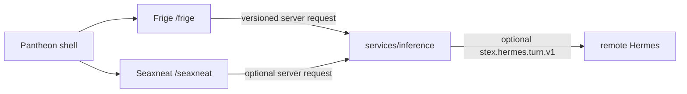

# STEX Pantheon A0

STEX is a local-first suite of independently owned creative applications. A0 implements Frige and Seaxneat under one loopback shell; Eostre and Woden are registered deferred products, not partial implementations.

Each application owns its own state. Pantheon routes HTTP but stores no
projects. Frige owns manuscript/proof state; Seaxneat owns ignored local
workspaces and Git history. `vault/` is an optional User Graph, never a shared
database. `services/knowledge` exposes only a replaceable read-only adapter.
`hermes/` holds declarative roles and profiles; `services/inference` remains
the authenticated, bounded application-facing inference contract. The local
fake enables deterministic workflows. Remote Hermes and providers are not
verified.

See [STATUS.md](STATUS.md) and [protocol documentation](../protocol/README.md).
