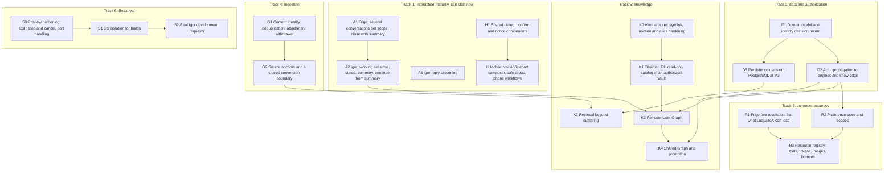

# Program: persistent workspaces and knowledge architecture

**State:** proposed by the owner on 2026-11-25. On the same day the owner
authorized A1, A2, S0 + K0, D1 and D2 ([D-027](DECISIONS.md#d-027--conversations-and-working-sessions-share-one-lifecycle),
[D-028](DECISIONS.md#d-028--a-verified-actor-reaches-the-engines),
[D-029](DECISIONS.md#d-029--no-shared-database-yet-postgresql-stays-the-m3-destination)).
The Press website stays out of scope (D-001 reaffirmed). Hermes agent memory
stays off. Everything else, and any push, release or paid call, still needs
the owner's authorization for the named operation (see the
[milestone loop](../../AGENTS.md#7-milestone-loop--between-increments)).

This file sequences the program and keeps its dependency graph. It does not
replace the existing records: [STATUS](../STATUS.md) says what is implemented,
the [transition plan](../PLATFORM-TRANSITION.md) holds the migration and
Obsidian gates, and the [master plan](MASTER-PLAN.md) holds Waves 0–7 and F.
Wave F (Frige product completion) continues alongside this program.

## Baseline

| Repository | Revision | Note |
| --- | --- | --- |
| stex-suite | `20c7984` (`main`) | Clean working tree |
| stex-igor | `a9b187f` (`origin/main`, generation 23) | Submodule pin on suite `main` |

The Press website was not examined. [D-001](DECISIONS.md#d-001--the-press-website-is-out-of-scope)
puts it out of scope. The new program names it "where relevant", so the owner
decides whether D-001 still holds.

## What exists today (from the code)

Classes: **I** implemented, **T** a test exists, **S** specified only, **A**
absent. Every row was read in code, not taken from documents.

### Conversations and sessions

| Capability | Igor | Frige |
| --- | --- | --- |
| Storage | One JSON store, per-account `owner` field (I, T) | One append-only JSONL thread per scope: book, section or piece (I, T) |
| Several conversations in one scope | Yes; each is bound to at most one project (I, T) | **A**: exactly one thread per scope |
| Rename | I, T | A |
| Archive (reversible) | `archived` flag (I, T) | A |
| Delete | Hard delete that stops a running turn (I, T) | A; the journal is append-only |
| End, complete, pause, states | A; only `idle`, `pending` and `failed` reply states | A |
| Summary | A | A |
| New conversation from earlier context | A; context epochs reset upstream history within one conversation | Partly: each turn inherits the last 12 turns and up to 8 approved contracts |
| Search | A | Navigator search covers pieces, not conversations |
| Streaming | A; the UI polls every second | Engine streams from the gateway; the browser waits for the result |
| Attachments in chat | A in Igor | Reviewed uploads per book (I, T) |
| Decisions linked to a conversation | — | Per-piece decision journal (D-026), not linked to threads |

### Data model, identity and storage

- **Persistence:** JSON files owned by each engine and service. The Python
  backend has one read-only route and no database dependency. No PostgreSQL,
  ORM or migration tool exists anywhere.
- **Identity:** Igor password accounts with `owner` and `member` roles (I, T).
  Hosted Pantheon asks Igor whether a request is signed in (D-023).
- **No actor reaches Frige, the knowledge journal or the Python backend.**
  Frige and knowledge state is shared by every signed-in account.
  Organization and membership: A.
- **Identifiers:** `stex://(frige|seaxneat)/project/<id>` and
  `#source=<id>` are emitted and parsed. The registry's other reference kinds,
  and `stex://knowledge/(concept|preference|commitment)/…`, are syntax only.
  Nothing resolves them.

### Knowledge, ingestion and Obsidian

- **Knowledge journal:** opt-in, one journal per deployment. It holds
  projects, sources and relations, keeps assertions and inferences apart,
  and records consent, revocation, erasure, export and idempotent replay
  (I, T). It stores no source text, no embeddings and no per-user partition.
- **Vault adapter:** unexposed, lexical path checks only. **`read()`
  follows a symlink; there is no realpath or lstat check**, and Windows
  aliases are unhandled. The transition plan requires this hardening before
  any vault read is exposed.
- **Ingestion:** Frige uploads (md, txt, tex, csv, json, pdf, docx; 8 MB
  each) convert through MarkItDown, and Igor's document tools read
  approved excerpts (I, T). Gaps:
  - the attachment id is not a content hash, so there is no deduplication;
  - attachments have no delete or withdrawal route;
  - nothing preserves page numbers or other source anchors;
  - retrieval is substring matching only.
- **Prompt injection:** imported text is placed after the system text and
  marked untrusted, and a person reviews it before it is used (I).
  There is no further control.

### Preferences and resources

- **Preferences:** none stored. The only browser preference is motion.
  Agent configuration is company-wide (D-016).
- **Fonts:**
  - Frige's body font is free text, resolved by LuaLaTeX against the
    installed system fonts. A missing font silently falls back to Latin
    Modern; preflight reports `TEXGRAPH-FONT-FALLBACK`.
  - Frige has no font list, registry or licence metadata.
  - The design system self-hosts four OFL families for the interface only.

### Seaxneat

- The only edit generator is the deterministic simulator, which replaces a
  heading. There is no Igor/Hermes path, repository import, file tree or
  editor (A).
- Git revisions, hash-guarded proposals, validated builds, and recovery to
  `needs_attention` (I, T).
- **Builds and previews run as the user's OS account**:
  - no container, resource limits or outbound network policy;
  - an allow-listed environment that still passes `HOME`.
- The preview's response header sets only `sandbox allow-scripts`, with no
  `default-src` or `connect-src`.
- There is no route to stop or cancel a preview, and nothing handles a
  preview port that is already in use.
- Seaxneat is deferred on the hosted VM until generated code has an OS
  boundary. STATUS's "implemented and tested locally" is accurate but does
  not mention the deferral.

### Interface and mobile

- **Shared components:** the design system offers buttons, frames and
  tokens only. Frige, Igor and Seaxneat each build their own dialogs,
  confirmations and notices, using `confirm()` and `prompt()` in several
  places.
- **Mobile layout:**
  - nothing uses `visualViewport`;
  - only standalone Igor sets `viewport-fit=cover` and safe-area insets;
  - Seaxneat has one breakpoint.
- **Browser verification:** the scripts cover 1440 down to 320 px for
  overflow and screenshots. The interactive workflows run at desktop
  width, apart from drawer and proof-view toggles. Nothing tests the
  virtual keyboard or touch.

## Conflicts and decisions for the owner

1. **Scope of authority.** Workstreams B (data model, PostgreSQL), C
   (organizations, preferences), E (Shared Graph, agent memory) and the
   `Job` entity cross the charter's explicit-authorization line. The
   program text calls itself proposed. Each milestone below therefore waits
   for a named approval.
2. **Identity is the root dependency.** Per-user preferences, a private
   User Graph, a Shared Graph, organizations and per-user Frige sessions all
   need a trusted actor reaching the engines. The remaining part of M2b
   ([transition plan](../PLATFORM-TRANSITION.md#milestone-roadmap)) has not
   been decided.
3. **Agent memory.** Hermes memory and background review were turned off
   on 2026-11-21 to close [R-15](RISKS.md). Workstream E's agent memory
   reopens that decision.
4. **Development subagents.** No OpenRouter-connected development agent is
   installed here. Reconnaissance used Claude development subagents, which
   are separate from the Hermes runtime (the runtime remains Grok-only).
5. **Press website.** See the baseline section above (D-001).

## Dependency graph

Independent today, with no new infrastructure: A1, A2, A3, H1, I1, R1, G1,
K0, S0 and the D1 decision record. Gated by owner decisions: D2 (identity),
D3 (database), S1 (container or VM boundary), K4 and any agent memory.

## First milestones (authorized 2026-11-25)

D1 is recorded as D-027 to D-029. D2 adds the verified actor
([`stex.platform.actor.v1`](../../protocol/platform/README.md#platform-actor-v1))
in Pantheon, the knowledge journal and Frige.

| Id | Objective | Contracts | Acceptance evidence |
| --- | --- | --- | --- |
| A1 | Frige scopes hold several named conversations. A conversation can be closed with a summary of the decisions, open proposals and questions. A new conversation starts from approved context, not the transcript. Closing never accepts, rejects or publishes | Additive routes under `stex.frige.publishing.v1`. The existing scope journal becomes that scope's first conversation, with no file moves | `test:frige` plus a `verify:frige` workflow at 1440 and 390 px |
| A2 | Igor conversations gain a kind (chat or working session) and states (active, paused, awaiting review, completed, abandoned), with archive kept separate. The summary is a structured, editable record. "Continue" starts a conversation seeded with the summary | Additive fields in `stex.igor.conversations.v1` and store v1 | `test:igor`, `verify:igor` at 1440 and 390 px; fake transport. Release is a separate stex-igor authorization |
| S0 + K0 | Security hardening that changes no product behaviour: preview `default-src`/`connect-src`, a preview stop route, port collision handling; vault adapter realpath and lstat checks with symlink and junction negative tests | No contract change | `test:seaxneat`, `verify:platform`, `test:knowledge` |
| D1 | Decision record covering: entities justified by A1, A2 and G1; actor propagation; organizations as an extension of individuals; PostgreSQL and pgvector against current JSON stores and migration cost | None (a document for decision) | Owner decision recorded in [DECISIONS](DECISIONS.md) |

## Change log

- 2026-11-25: reconnaissance, baseline and graph recorded.
- 2026-11-25: A1, A2, S0 + K0, D1 and D2 authorized; D-027 to D-029 recorded.
