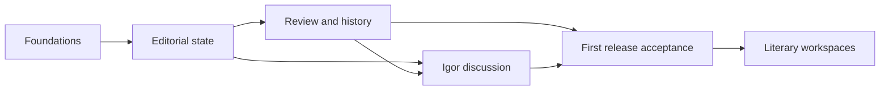

# Frige editorial systems

## Phase A implementation matrix

The 2026-11-23 baseline is stex-suite `b06ebea` and stex-igor `e9c0d85`.
Both match their remote `main` heads. The private checkout is attached to
its existing feature branch at the same commit. Operational evidence below
includes historical releases. The [Phase A verification report](../verification/frige-editorial-foundations.md)
records checks run on this baseline and the foundation changes.

| Capability | Baseline classification | Existing implementation and remaining work |
| --- | --- | --- |
| Navigator and addresses | Implemented but incomplete | Book, section and piece hierarchy, collapsible sections, title/path filter, keyboard movement, deep links, browser history and pending/unsaved marks work. Add breadcrumbs, focus mode and explicit reordering through the Programme. There is no independent part/chapter model. Closed sections render their piece rows on demand. [Navigation evidence](../verification/frige-ui-1-navigation-passages.md) |
| Composition | Implemented but incomplete | Pantheon serves a Markdown textarea, cursor/selection position, native undo/redo, save shortcut and explicit stale-checked save. Autosave, configurable writing typography, visible line numbers, counts, find/replace and split writing are missing. Save completion can replace text typed while the request was pending. The textarea normalizes CRLF and CR to LF before save. |
| Passage selection | Implemented and operational | Frige validates the exact range, text and source hash in the offered piece. The private gateway has shipped the selection adapter. Exact byte restoration of an accepted anchored change was demonstrated with synthetic sources. [Passage evidence](../verification/frige-wave-f-anchored-edits.md) |
| Proposal and decision workflow | Implemented but incomplete | A persisted change contract links the request, proposal provenance, before/after source, explanation, individual piece decisions and proof. Pending proposals cannot write canonically. Multiple anchors in one piece form one change, so deciding individual edits within that piece, refining them in review and reopening the originating discussion are missing. A newer proposal supersedes the previous pending set in the same scope. [Change contract](../../protocol/frige/README.md#change-contracts-v1) |
| Comparison | Implemented but incomplete | Inline line diff with collapsed context and whitespace-preserving display exists for proposals. Add side-by-side review and reusable comparison across independent revisions. |
| Change journal and rollback | Implemented in backend with limited UI | Engine exposes metadata-only listing, full contract lookup and guarded rollback of an accepted proposal. The workstation shows contracts in their scoped threads and uses the list for review status. General document history and restoring an arbitrary revision are missing. [Protocol](../../protocol/frige/README.md#publishing-v1) |
| Source revisions | Missing | The source hash identifies content. Manual saves have no revision event or parent chain and repeating bytes repeat the hash. Existing acceptance has an interrupted-apply record. Direct saves have no durable journal. Multi-piece rollback prechecks the batch and can finish only part of it on an I/O failure. [Acceptance evidence](../verification/frige-atomic-acceptance-w3d.md) |
| Editorial annotations and decisions | Missing | Existing manuscript editorial footnotes are print content. Contract decisions record what was accepted or rejected. Add independent whole-piece and exact-passage notes, safe relocation, resolution state and author-authored reasons for choosing or retaining a reading. |
| Igor context and continuity | Implemented but incomplete | Frige owns separate book, section and piece threads and assembles bounded hierarchy and source context. It stores passage provenance on the user turn; the browser clears the passage after send and the gateway receives recent turns as role and message. A normal follow-up loses the exact passage and the write bound. Add explicit continuation from a recorded turn, recheck the source on each continuation and stop stale proposals. [Context evidence](../verification/frige-hierarchical-context-w3c.md) |
| Editorial actions | Implemented but incomplete | The selection toolbar has Ask, Revise, Explain, Alternatives and Compare. Existing non-Ask actions constrain proposals to the passage. Information-only actions still need a contract-enforced no-proposal mode. Critique, Condense, Expand, Annotate, Research, Translate and Proofread need explicit workflows. [Selected passages](../../protocol/frige/README.md#selected-passages) |
| Project access | Implemented and operational for shared projects | Hosted Pantheon requires Igor sign-in, and Frige separately enforces optional per-project passwords. All signed-in accounts share Frige projects under [D-023 and D-024](DECISIONS.md#d-023--hosted-pantheon-uses-igors-accounts-as-its-sign-in). Frige receives no trusted per-account actor. Test signed-out, locked and unlocked cases for every new endpoint. Per-account isolation or verified account attribution requires an explicit identity/ownership decision. [Hosted evidence](../verification/hosted-pantheon.md) |
| Proofs and publication | Implemented and operational | LuaLaTeX proof, compiler-verified pagination, preflight, scoped layout and local publication staging already exist. Exercise the accepted and restored revisions with real PDF generation. [Publishing evidence](../verification/platform-transition-p2.md) |
| Specialist execution and memory | Specified with runtime limits | Igor alone is active. The Company owns configuration; seven specialist profiles remain parked, tools are disabled and persistent Hermes memory is off. Keep reusable editorial knowledge in Frige's decision records. Runtime activation has separate security and owner gates. |
| Literary workspaces | Missing | Existing verse parsing preserves lineation for proofs. Interactive prosody, translation alignment and scholarly apparatus need their own validated workflows in the second wave. |
| Compatibility surfaces | Deprecated or redundant for new work | Keep the one-page TexGraph client contract, redirects and legacy book operations working. Retired provider-roster operations stay retired. New features use the normal Frige manuscript entry point. |

## Delivery dependencies

1. **A · Audit and foundations.** Confirm the baseline, verify source
   preservation and concurrency, and establish the limits of the existing
   storage, write and access contracts.
2. **B · Editorial state.** A precedes persistent revision events. Reuse
   Frige's source-write guard and its private project state. Give each event
   a unique id plus content hash and preceding event id, including when a
   restore repeats a hash. Record author action and Igor proposal provenance
   separately. Use exact content snapshots with deduplication by hash as the
   initial storage design. Define the commit and recovery relationship to the
   current acceptance intent before recording proposal revisions. Capture an
   explicit baseline for existing files and a discontinuity for external
   changes. Passage annotations and decisions can use revision ids once the
   read boundary exists. Leave ambiguous or changed anchors unresolved.
3. **C · Review and history.** B supplies history and restoration. Reuse the
   existing line diff and proposal journal for comparison and inspectable,
   individually decided edits. Make refinement an explicit reviewed proposal
   and carry the reason and source references into the decision record.
4. **D · Igor discussion.** A supplies verified selection and access
   semantics, and B/C supply editorial references and review. Add opt-in
   continuation from an authored passage turn and a separate informational
   intent. Pass only bounded, selected context. Keep existing v1 publishing
   and v3 turn clients compatible and give any new cross-application
   semantics a versioned contract.
5. **F · First release acceptance.** B, C and D precede the full browser
   scenario. Verify criticism, alternatives, anchored proposal, selective
   decisions, source, history, restoration and a real proof against synthetic
   poetry, prose, translation and a long piece. Cover concurrent saves,
   stale proposals, access and narrow-screen keyboard operation. Capture
   release readiness after independent review.
6. **E · Second wave.** Use the accepted revision and decision model for
   translation alignment, interpretive poetry analysis and initial witness
   and variant records. The directive's priority places these after the core
   editorial release.

New state is Frige-owned inside the selected project. Pantheon renders it
through Frige's HTTP boundary. Igor receives authorized context through the
existing inference service. A content comparison, a note and an Igor reply
have no authority to commit source. Canonical source remains the manuscript;
restore is a new author-approved revision. Design proposals, compatibility
pages and compiler evidence retain their existing ownership.

The [single-piece Phase B increment](../verification/frige-editorial-state.md)
provides the history, restore and decision API for direct source edits.
Proposal transaction integration and anchored editorial annotations
remain Phase B work.
